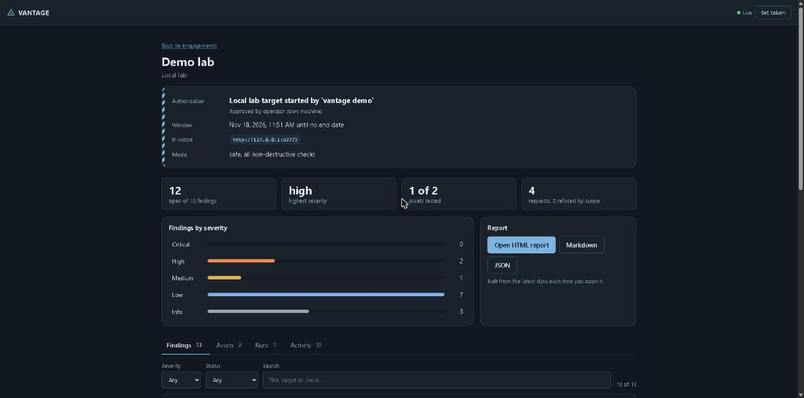

# VANTAGE

A security assessment workbench for systems **you own or have written permission to test**. It runs DNS, email and web configuration checks, captures evidence for every finding, writes client-ready reports, and shows progress live in a local dashboard.



## Safety model

- **One choke point.** Every DNS query, TCP probe and HTTP request goes through `ScopeGuard`. Modules cannot open sockets themselves.
- **Scope is enforced, not advisory.** Targets come from the engagement scope (hosts, `*.wildcards`, IPs, CIDRs, URL origins). Redirects and DNS-resolved IPs are re-checked. Exclusions always win, and refusals are logged.
- **Authorization is recorded.** Each engagement carries an authorization reference, an authorizer and a time window. Outside the window, the guard refuses to send anything.
- **Non-destructive only.** Read-only HTTP methods, a request budget, rate limits and timeouts. There is no exploitation, brute forcing or fuzzing, and no mode enables them.
- **Evidence or it didn't happen.** Each finding links to redacted request/response captures. Cookies and auth headers are scrubbed.
- **The dashboard binds to 127.0.0.1 only.** Changing a finding's status requires the token printed at startup.

## Quick start

Requires Node 22 or newer. There are no dependencies to install.

```
node bin/vantage.js demo --serve
```

This starts a deliberately misconfigured lab server on loopback, assesses it, writes reports, and opens the dashboard at http://127.0.0.1:7341. The demo finds 13 issues: reflected-origin CORS with credentials, missing security headers, version disclosure, and weak cookie flags.

## Real engagements

```
node bin/vantage.js init acme-lab \
  --target https://app.acme.example --target "*.acme.example" \
  --auth-ref "SOW-2026-114, signed 2026-11-01" --authorized-by "Jane Doe (CISO)" \
  --ends 2026-12-31 --mode safe
node bin/vantage.js run acme-lab --serve   # live dashboard while it runs
node bin/vantage.js report acme-lab        # rebuild HTML / Markdown / JSON reports
node bin/vantage.js modules                # list checks
```

Edit `data/engagements/<id>/engagement.json` to set exclusions, port policy and rate limits. Modes:

- `passive`: DNS and headers only
- `safe`: all non-destructive checks (the default)
- `full`: adds longer content discovery

## Checks

| Module | What it looks at |
| --- | --- |
| `recon.dns` | A/AAAA/CNAME/MX/NS/SOA records, dangling CNAMEs |
| `recon.email` | SPF, DMARC, and DKIM selector presence |
| `recon.subdomains` | Short in-scope subdomain wordlist, resolved through the guard |
| `web.headers` | HSTS, CSP, framing, MIME sniffing, COOP/COEP/CORP, version disclosure |
| `web.cookies` | Secure, HttpOnly, SameSite, prefixes, overly broad domain |
| `web.cors` | Reflected origins, `null` origin, credentials with wildcards |

Every module exports pure `analyze*` helpers that are tested without a network. The rules for adding a module are in [ENGINEERING.md](ENGINEERING.md).

## Reports

`data/engagements/<id>/reports/<timestamp>/` contains:

- `report.html`, the deliverable, printable
- `report.md`
- `report.json`, a stable schema

Each report has an executive summary with a risk rating, a severity table, scope, findings with remediation, CWE/OWASP mapping and evidence IDs, methodology, limitations, and a disclaimer. Target-controlled text is HTML-escaped.

## Development

```
npm test        # 76 tests, all on loopback, no internet needed
npm run smoke   # import/instantiation smoke test
```

## Layout

```
bin/vantage.js        CLI
src/core/             scope, guard, rate limits, evidence, audit, store, engine
src/modules/          recon and web checks (auto-discovered)
src/report/           JSON, Markdown, HTML reports
server/ ui/           loopback dashboard (HTTP + SSE, vanilla JS)
examples/             lab target used by the demo and e2e tests
test/                 node:test suites
```

## Legal

Use VANTAGE only against systems you own or are explicitly authorized in writing to assess. You are responsible for staying within your authorization.

## License

MIT
